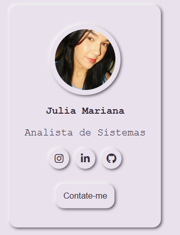

# 💜 Card Profile — Julia Mariana

Projeto de desenvolvimento de um cartão de perfil pessoal utilizando **HTML5 e CSS3**, com foco em estilização, alinhamento de elementos e aplicação de efeitos visuais.

## 🎨 Preview do projeto

## 🚀 Tecnologias utilizadas

- HTML5
- CSS3
- Flexbox
- Font Awesome
- Google Fonts

## ✨ Funcionalidades e recursos

- Layout de cartão de perfil.
- Organização e alinhamento de elementos com Flexbox.
- Ícones de redes sociais.
- Botão de contato.
- Bordas arredondadas.
- Efeito Neumorphism com `box-shadow`.
- Utilização de variáveis CSS (`:root`).
- Personalização de cores, fontes e espaçamentos.

## 📚 Aprendizados

Durante o desenvolvimento, pratiquei conceitos importantes de HTML e CSS, como:

- Estruturação semântica e organização HTML.
- Seletores CSS.
- `display: flex`, `justify-content` e `align-items`.
- `padding`, `gap` e dimensões dos elementos.
- `border-radius` e `box-shadow`.
- Personalização de componentes visuais.

## 👩‍💻 Desenvolvido por

**Julia Mariana**

Estudante de Análise e Desenvolvimento de Sistemas (ADS).

[GitHub](https://github.com/) 

---

*Projeto desenvolvido com o objetivo de praticar e aprimorar meus conhecimentos em desenvolvimento web.*
